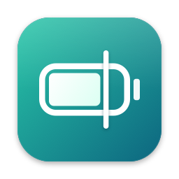
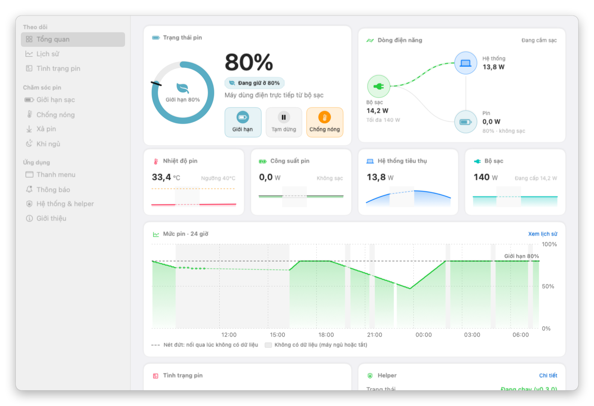
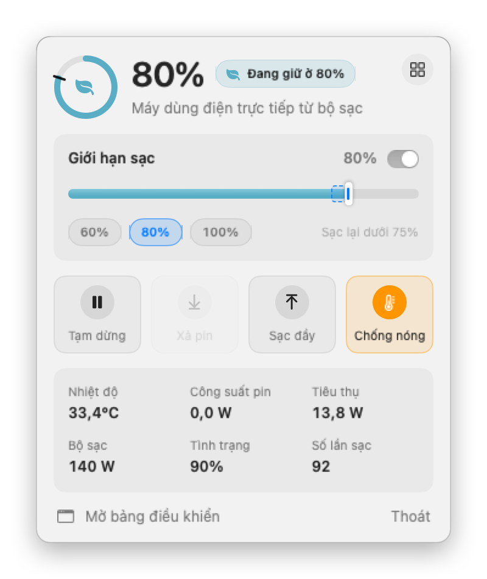
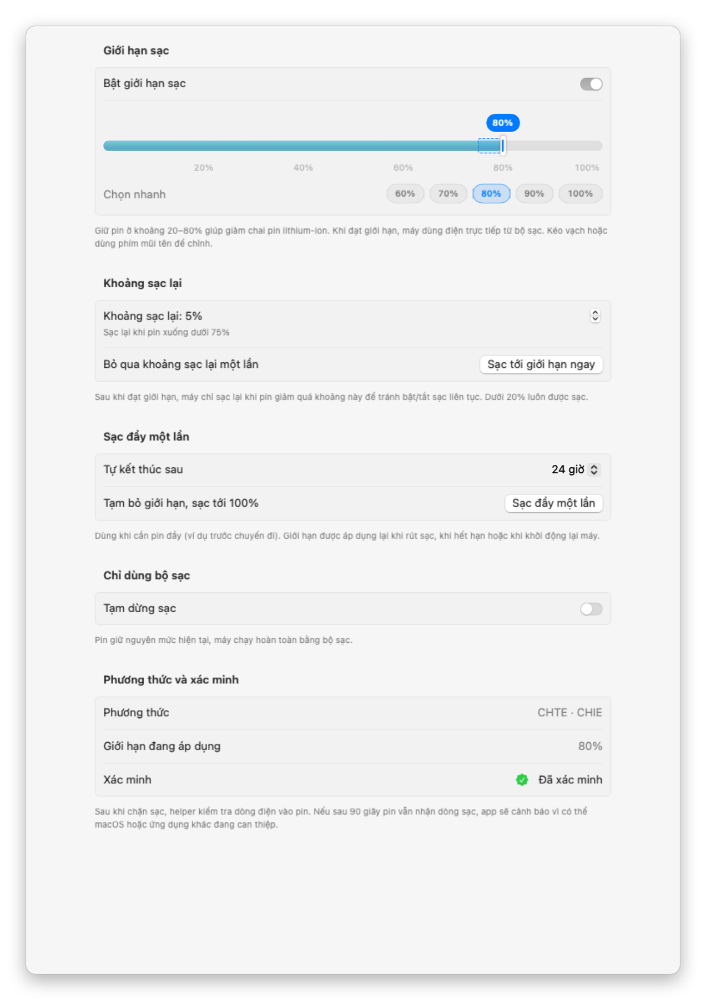
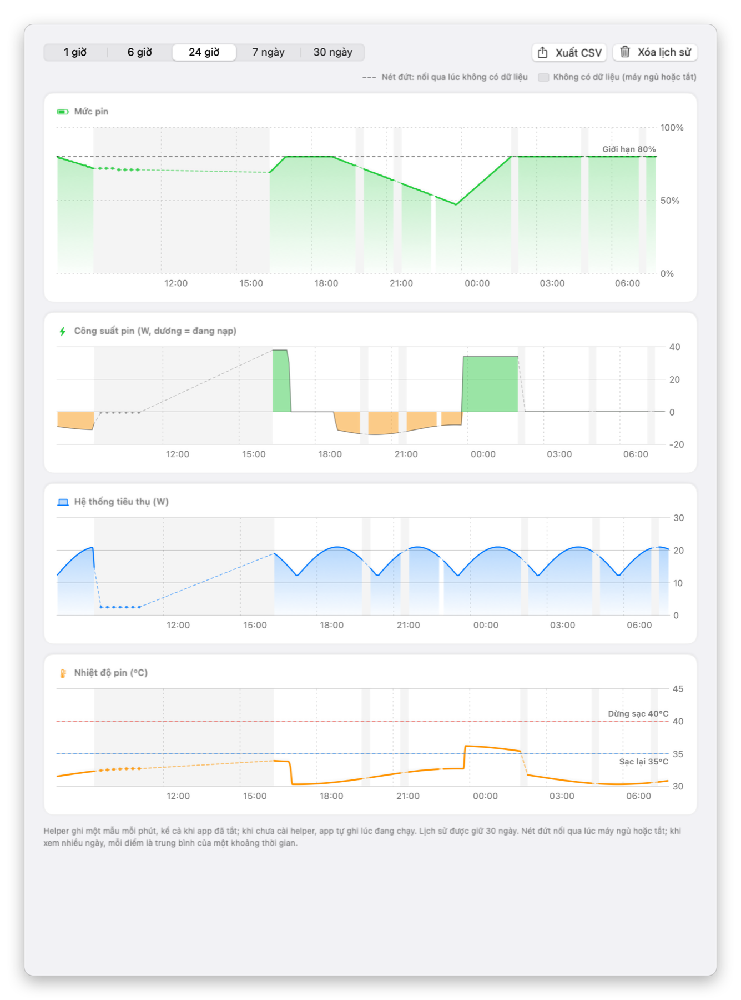
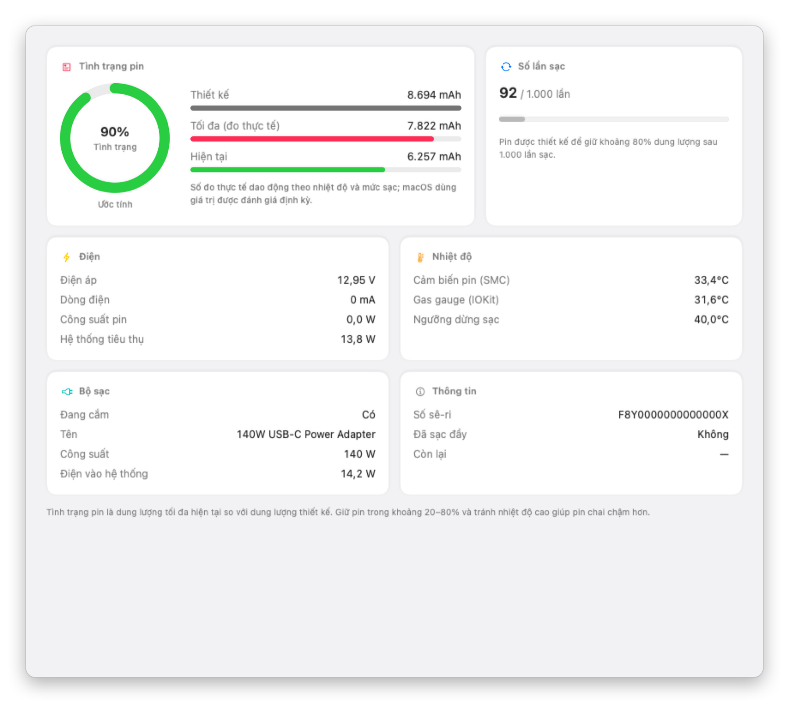
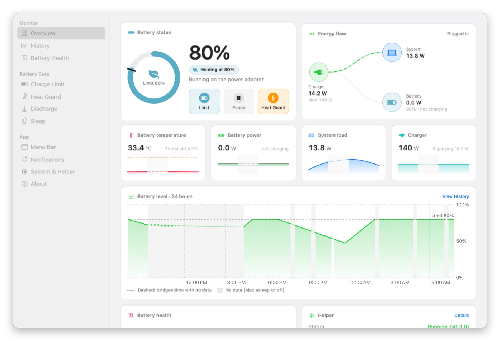

<p align="center">
  
</p>

<h1 align="center">MacPowerManager</h1>

<p align="center">
  <b>Quản lý pin &amp; sạc miễn phí, mã nguồn mở cho MacBook</b><br>
  <sub>Free, open-source battery care for Mac · <a href="#english">English</a></sub>
</p>

<p align="center">
  <a href="https://github.com/hasoftware/MacPowerManager/releases/latest"></a>
  <a href="https://github.com/hasoftware/MacPowerManager/actions/workflows/ci.yml"></a>
  <a href="LICENSE"></a>
  
  <a href="https://t.me/hoanganhdev"></a>
</p>

<p align="center">
  <a href="https://github.com/hasoftware/MacPowerManager/releases/latest"><b>⬇️ Tải bản mới nhất</b></a> ·
  <a href="#tính-năng">Tính năng</a> ·
  <a href="#ảnh-chụp">Ảnh chụp</a> ·
  <a href="#tải-về-không-cần-build">Cài đặt</a> ·
  <a href="#tác-giả">Tác giả</a>
</p>

<p align="center">
<picture>
  <source media="(prefers-color-scheme: dark)" srcset="docs/screenshots/vi/window-dark.png">
  
</picture>
</p>

Phát triển bởi **[HASOFTWARE](https://github.com/hasoftware)**. App mã nguồn mở, miễn phí, để quản lý pin và sạc trên MacBook:
giới hạn sạc, sạc đầy một lần, xả pin, chống nóng, lịch sử pin 30 ngày và thông báo.
Đây là dự án vì cộng đồng, là một lựa chọn thay thế miễn phí cho các app giới hạn sạc trả phí.

> ⚠️ **Lưu ý:** App điều khiển sạc bằng cách ghi vào các SMC key không được Apple công bố.
> Đã thử nghiệm trên MacBook Pro M2 Pro, macOS 15.5. Hãy dùng với sự hiểu biết về rủi ro (xem [Giấy phép](#giấy-phép), phần không bảo hành).

## Tính năng

- **Theo dõi hệ thống**: CPU (từng nhân, nhiệt độ, tải), bộ nhớ (áp lực, swap, phân loại) với biểu đồ 1 phút – 1 giờ;
  chỉ đo khi bảng điều khiển đang mở.
- **Thông tin pin**: %, dung lượng (mAh), sức khỏe, chu kỳ, điện áp, dòng, công suất, nhiệt độ (SMC + IOKit), adapter.
- **Sạc đầy theo lịch**: chọn ngày và giờ cần pin đầy (ví dụ 8:00 các ngày làm việc), helper tự sạc sớm vừa đủ, kể cả
  khi máy đang ngủ, rồi trở về giới hạn.
- **Hiệu chuẩn pin**: một nút bấm chạy chu trình đầy → 15% → đầy để số % và dung lượng tối đa chính xác lại, kèm nhắc
  mỗi 2 tháng.
- **Đèn MagSafe báo trạng thái**: xanh khi pin được giữ ở giới hạn (thay vì cam mãi), cam khi sạc, hoặc luôn tắt.
- **Sức khỏe theo thời gian**: mỗi ngày ghi một điểm, vẽ biểu đồ nhiều tháng, tính tốc độ chai pin mỗi năm và ước tính
  còn bao lâu pin xuống dưới 80%.
- **Giới hạn sạc**: dừng sạc ở X% và chỉ sạc lại khi pin giảm quá **khoảng sạc lại** (chỉnh được), tránh bật/tắt sạc liên tục.
  - **Sạc tới giới hạn ngay**: bỏ qua khoảng sạc lại một lần, sạc thẳng tới giới hạn rồi tự tắt.
  - **Sạc đầy một lần**: sạc tới 100% một lần (ví dụ trước chuyến đi); giới hạn trở lại khi rút sạc hoặc hết hạn.
- **Tạm dừng sạc**: máy chạy hoàn toàn bằng adapter, pin giữ nguyên.
- **Xả pin**: ngắt adapter bằng phần mềm để xả về mức mục tiêu dù vẫn cắm sạc, sau đó tự tắt.
- **Chống nóng**: dừng sạc khi pin ≥ ngưỡng nóng và sạc lại khi đã nguội (hysteresis).
  Apple Silicon không cho phần mềm chỉnh dòng sạc, nên đây là cách giảm công suất và nhiệt khi sạc.
- **Kiểm tra hiệu lực**: sau khi chặn sạc, helper đo dòng điện vào pin; nếu pin vẫn nhận sạc, app cảnh báo.
- **Phát hiện xung đột**: nhận biết ứng dụng điều khiển sạc khác (AlDente, batt, Battery Toolkit, actuallymentor/battery)
  đang cài hoặc đang chạy, và cảnh báo khi có tiến trình khác ghi vào SMC key mà helper quản lý.
- **Lịch sử & thông báo**: biểu đồ % / nhiệt độ / công suất trong 7 ngày; thông báo khi đạt giới hạn, pin nóng, xả xong,
  pin yếu, lệnh dừng sạc chưa có hiệu lực, có ứng dụng khác điều khiển sạc.
- **Giao diện**: popover trên thanh menu và cửa sổ có thanh bên với các trang Tổng quan, Lịch sử, Tình trạng pin,
  Giới hạn sạc, Chống nóng, Xả pin, Khi ngủ, Thanh menu, Thông báo, Hệ thống & helper, Giới thiệu.
- **Tiếng Việt và tiếng Anh**: giao diện theo ngôn ngữ của macOS; ngôn ngữ khác hiển thị tiếng Anh.
- **Kiểm tra cập nhật**: lúc mở app và mỗi 24 giờ, app xem GitHub có bản mới không và hiện banner, thông báo
  (một lần cho mỗi phiên bản) cùng cửa sổ **Có gì mới** với ghi chú thay đổi. Bạn tự chọn tải về, bỏ qua bản đó
  hoặc để sau; app không tự tải hay cài gì. Tắt được ở trang **Giới thiệu**.

Vòng điều khiển chạy trong một helper nền (LaunchDaemon), nên giới hạn sạc vẫn có hiệu lực khi app đã thoát.

## Ảnh chụp

<table>
  <tr>
    <td width="38%" align="center">
<picture>
  <source media="(prefers-color-scheme: dark)" srcset="docs/screenshots/vi/popover-holding-dark.png">
  
</picture>
      <br><sub>Bảng nhanh trên thanh menu</sub>
    </td>
    <td align="center">
<picture>
  <source media="(prefers-color-scheme: dark)" srcset="docs/screenshots/vi/page-limit-dark.png">
  
</picture>
      <br><sub>Giới hạn sạc, khoảng sạc lại, sạc đầy một lần</sub>
    </td>
  </tr>
  <tr>
    <td colspan="2" align="center">
<picture>
  <source media="(prefers-color-scheme: dark)" srcset="docs/screenshots/vi/page-history-day-dark.png">
  
</picture>
      <br><sub>Lịch sử 30 ngày do helper ghi, kể cả khi app đã thoát; đoạn máy ngủ vẽ bằng nét đứt</sub>
    </td>
  </tr>
  <tr>
    <td colspan="2" align="center">
<picture>
  <source media="(prefers-color-scheme: dark)" srcset="docs/screenshots/vi/page-health-dark.png">
  
</picture>
      <br><sub>Tình trạng pin theo macOS, số lần sạc, điện áp, nhiệt độ</sub>
    </td>
  </tr>
</table>

Giao diện có cả tiếng Việt và tiếng Anh (chọn trong **Thanh menu → Ngôn ngữ**), tự theo chế độ sáng/tối.

## Yêu cầu

- macOS 14 Sonoma trở lên
- **Apple Silicon (M1 trở lên)**: đầy đủ tính năng
- **Intel (2018–2020, chip T2)**: thông tin pin, lịch sử, thông báo, và **điều khiển sạc thử nghiệm** qua `BCLM`
  (giới hạn 50–100%, tạm dừng, bảo vệ nhiệt; chưa hỗ trợ xả pin). Firmware giữ giới hạn cả khi máy tắt,
  pin có thể vượt khoảng 3%. Nếu bạn dùng máy Intel, hãy gửi kết quả `make probe` và trải nghiệm qua
  [Issues](https://github.com/hasoftware/MacPowerManager/issues) để giúp hoàn thiện.

## Tải về (không cần build)

1. Vào [Releases](https://github.com/hasoftware/MacPowerManager/releases/latest) và tải file **MacPowerManager-x.y.z.dmg**.
2. Mở file `.dmg` và kéo **MacPowerManager** vào **Applications**.
3. Mở app. App chưa được ký bằng Apple Developer ID nên macOS sẽ chặn lần đầu:
   vào **System Settings → Privacy & Security**, kéo xuống và bấm **Open Anyway**.
4. Bấm biểu tượng pin trên thanh menu → **Cài helper** và nhập mật khẩu quản trị.
   **Sau mỗi lần cập nhật app phải cài lại helper** (app sẽ nhắc): helper chỉ nhận lệnh từ đúng bản app đã cài nó
   (ghim theo cdhash), nên bản app mới chưa điều khiển được sạc cho tới khi cài lại.

## Tự động hóa (dòng lệnh và Phím tắt)

Cài lệnh `mpm` trong **Hệ thống & helper → Dòng lệnh & Phím tắt** (cần mật khẩu quản trị một lần), rồi:

```sh
mpm status            # trạng thái pin và sạc (thêm --json cho script)
mpm limit 80          # đặt giới hạn 80%  ·  mpm limit off
mpm pause on          # tạm dừng sạc       ·  mpm resume
mpm topup 4           # sạc đầy một lần, tự kết thúc sau 4 giờ  ·  mpm topup cancel
mpm discharge 50      # xả về 50% khi đang cắm sạc  ·  mpm discharge stop
mpm calibrate         # hiệu chuẩn pin  ·  mpm calibrate cancel
mpm magsafe status    # đèn MagSafe: system | status | off
```

Trong app **Phím tắt** (Shortcuts): dùng tác vụ *Chạy tập lệnh shell* với `mpm …`, hoặc *Mở URL* với
`macpowermanager://limit/100`, `macpowermanager://pause/on`, `macpowermanager://topup/4`… Xả pin và hiệu chuẩn chỉ chạy
bằng `mpm` (URL có thể bị mở từ trang web nên không được ngắt bộ sạc).

`mpm` chính là app chạy ở chế độ dòng lệnh, nên helper nhận lệnh như từ app mà không cần cấp thêm quyền.

## Cập nhật

Từ v0.5.0, app tự kiểm tra bản mới. Bấm **Cập nhật ngay** trong cửa sổ **Có gì mới**: app tự tải, kiểm tra chữ ký số
(Ed25519, khóa của HASOFTWARE) và cài bản mới rồi mở lại. Từ các bản sau v0.6.0, **helper tự cập nhật cùng app, không cần mật khẩu**: helper kiểm tra
lại chữ ký của bản mới rồi tự thay mình. App chỉ nhắc cài lại helper (cần mật khẩu quản trị) khi helper đang dùng quá cũ
hoặc bản mới đổi cấu hình LaunchDaemon.

## Quyền riêng tư

Dữ liệu pin (lịch sử 7 ngày, cài đặt) chỉ nằm trên máy của bạn. Yêu cầu mạng **duy nhất** của app là kiểm tra cập nhật:
một lệnh `GET https://api.github.com/repos/hasoftware/MacPowerManager/releases/latest` lúc mở app và mỗi 24 giờ.
Yêu cầu này không kèm dữ liệu cá nhân hay dữ liệu pin (chỉ có User-Agent `MacPowerManager/<version>` và ETag để
GitHub trả 304 khi không có gì mới); GitHub vẫn thấy địa chỉ IP như mọi kết nối web. Tắt ở **Giới thiệu → Tự động
kiểm tra cập nhật**; helper (root) không bao giờ kết nối mạng.

## Build từ mã nguồn

Cần Xcode 16+.

```sh
git clone https://github.com/hasoftware/MacPowerManager.git
cd MacPowerManager
make install        # build và copy MacPowerManager.app vào /Applications
open /Applications/MacPowerManager.app
```

Lần đầu mở app, bấm **Cài helper** và nhập mật khẩu quản trị. Helper cần quyền root để ghi SMC.

> **Không chạy song song với AlDente, batt hoặc app giới hạn sạc khác.** Chúng ghi cùng SMC key nên sẽ xung đột.
> Hãy gỡ helper của app kia trước.

### Các lệnh khác

```sh
make run       # build và mở app từ thư mục build/
make test      # chạy unit test
make check-l10n  # kiểm tra bản dịch (chạy được với python3 có sẵn của macOS)
make probe     # xem các SMC key liên quan tới sạc trên máy
make package   # build universal và tạo dist/*.dmg, dist/*.zip
```

## Gỡ cài đặt

1. Mở app → **Hệ thống & helper** → **Gỡ helper…** (hoặc `make uninstall-helper` nếu build từ mã nguồn). Sạc sẽ trở về mặc định của macOS.
2. Xóa `/Applications/MacPowerManager.app` và `~/Library/Application Support/MacPowerManager`.

Nếu đã lỡ xóa app trước khi gỡ helper, chạy trong Terminal:

```sh
H=/Library/PrivilegedHelperTools/com.hasoftware.MacPowerManager.helper
sudo launchctl bootout system/com.hasoftware.MacPowerManager.helper
grep -q -- --restore-defaults "$H" && sudo "$H" --restore-defaults
sudo rm -f "$H" /Library/LaunchDaemons/com.hasoftware.MacPowerManager.helper.plist
sudo rm -rf "/Library/Application Support/MacPowerManager"
```

- **Apple Silicon**: helper tự khôi phục sạc khi bị dừng; nếu không chắc, khởi động lại máy để SMC trở về mặc định.
- **Intel**: dòng `--restore-defaults` là bắt buộc. Giới hạn `BCLM` được lưu trong firmware và **không** mất khi
  khởi động lại. Nếu đã lỡ xóa helper, cài lại app rồi chạy
  `sudo /Applications/MacPowerManager.app/Contents/MacOS/PowerHelper --restore-defaults`, hoặc reset SMC.

## Kiến trúc

| Target | Vai trò |
|---|---|
| `CSMC` | C: đọc/ghi SMC qua IOKit `AppleSMC` |
| `PowerCore` | Model, `ChargeController` (logic thuần, có unit test), đọc pin, giao thức XPC |
| `PowerHelper` | LaunchDaemon (root): vòng điều khiển 10s, ghi SMC, xử lý ngủ/thức, XPC |
| `MacPowerManager` | App SwiftUI: `MenuBarExtra` và cửa sổ chi tiết |
| `smc-probe` | CLI chẩn đoán SMC key |

SMC key được dò theo firmware: `CHTE`/`CHIE` (mới) hoặc `CH0C`/`CH0I` (cũ; `CH0B` để lại cho Optimized Battery Charging của macOS) trên Apple Silicon,
`BCLM` trên Intel (thử nghiệm; firmware tự giữ giới hạn, helper không khôi phục khi tắt máy mà chỉ khi gỡ cài đặt).

### Cơ chế an toàn
- Pin ≤ 10% thì luôn bật adapter và cho phép sạc.
- Apple Silicon: helper nhận SIGTERM (gỡ, `launchctl bootout`, tắt máy) thì khôi phục sạc + adapter về mặc định.
  Intel: giới hạn `BCLM` được firmware giữ cả khi helper dừng hoặc máy tắt; chỉ gỡ helper mới trả về 100%.
- Trước khi ngủ luôn bật lại adapter. Chế độ xả không được khôi phục sau khi helper khởi động lại.
- Helper chỉ nhận kết nối XPC từ đúng bản app đã cài nó: script cài đặt ghi cdhash của app vào
  `/Library/Application Support/MacPowerManager/trusted-clients.json` (chỉ root ghi được). Mọi cấu hình nhận được đều bị kẹp về khoảng an toàn.

### Giới hạn đã biết
- **Chưa có Apple Developer ID**: app ký ad-hoc nên phải bấm *Open Anyway* lần đầu. Helper ghim client XPC theo cdhash
  của bản app đã cài, vì vậy mỗi bản app mới (cdhash khác) cần **cài lại helper**. Dù vậy, không tiến trình nào qua được
  mức an toàn 10% hay ghi SMC tùy ý qua helper.
  Khi có Developer ID, có thể build với `SIGN_ID="Developer ID Application: …" make app` và thêm điều kiện Team ID
  (`anchor apple generic and certificate leaf[subject.OU] = "TEAMID"`) vào `Sources/PowerHelper/XPCService.swift`.
- Helper được cài bằng script chạy quyền admin từ bên trong app bundle (không dùng `SMAppService`).
- Không chỉnh được dòng sạc trên Apple Silicon. Bảo vệ nhiệt hoạt động bằng cách tạm ngắt sạc.

## Đóng góp

Rất hoan nghênh issue và pull request!
- Chạy `make test` và `make check-l10n` trước khi gửi PR. CI sẽ tự kiểm tra bản dịch, build và test trên macOS.
- Chuỗi giao diện viết bằng tiếng Việt trong mã (đó là khóa); thêm bản dịch tiếng Anh vào
  `Resources/Localization/en.lproj/Localizable.strings` (số nhiều: `Localizable.stringsdict` của cả `en.lproj` và `vi.lproj`).
- Ghi thay đổi vào mục `[Unreleased]` trong [CHANGELOG.md](CHANGELOG.md).
- Icon và logo được vẽ bằng code: sửa `scripts/make-icons.swift` rồi chạy `swift scripts/make-icons.swift`.
  Ảnh chụp trong README tạo bằng `./scripts/make-screenshots.sh` (dữ liệu mẫu, tiếng Việt và tiếng Anh, sáng/tối).

### Version & phát hành

Dự án dùng [Semantic Versioning](https://semver.org/lang/vi/). Nguồn duy nhất của version là file `VERSION`.
Helper dùng chung version với app, nên mỗi bản mới app sẽ nhắc người dùng cài lại helper.

```sh
make bump-patch    # sửa lỗi:            0.1.0 -> 0.1.1
make bump-minor    # thêm tính năng:     0.1.1 -> 0.2.0
make bump-major    # thay đổi lớn:       0.2.0 -> 1.0.0
git push --follow-tags
```

Lệnh bump sẽ cập nhật `VERSION`, `Sources/PowerCore/Version.swift` và `CHANGELOG.md`, rồi commit và tạo tag `vX.Y.Z`.
Khi tag được đẩy lên, GitHub Actions sẽ build bản universal, đóng gói `.dmg`/`.zip` và tạo Release.
- Nếu máy của bạn khác (M1/M3/M4, macOS khác), gửi kết quả `make probe` trong issue để mở rộng hỗ trợ.

## English

<p align="center">
<picture>
  <source media="(prefers-color-scheme: dark)" srcset="docs/screenshots/en/window-dark.png">
  
</picture>
</p>

**Download:** grab the `.dmg` from [Releases](https://github.com/hasoftware/MacPowerManager/releases/latest), drag the app to Applications, and allow it via *System Settings → Privacy & Security → Open Anyway* (not notarized yet). Then click the menu bar icon → **Install Helper**. **Reinstall the helper after every app update**: the helper only accepts commands from the exact app build that installed it (pinned by cdhash), so a new build cannot control charging until you reinstall.


MacPowerManager is a free, open-source (GPL-3.0) menu bar app for Apple Silicon MacBooks. Features:
- charge limit with an adjustable recharge margin
- Charge to Limit Now (skip the recharge margin once) and Full Charge Once (charge to 100% once; the limit returns when you unplug)
- pause charging (run from the adapter)
- discharge while plugged in
- Heat Guard (pause charging above a temperature threshold, resume once cool)
- effect verification: after blocking charging the helper checks that the battery really stopped charging and warns you if not
- conflict detection: other charge controllers (AlDente, batt, Battery Toolkit, actuallymentor/battery) and foreign writes to the SMC keys the helper manages
- scheduled full charge ("full by 8:00 on weekdays"), even while the Mac sleeps
- system monitor: CPU per core and temperature, memory pressure and swap
- `mpm` command line and `macpowermanager://` URLs for Shortcuts and scripts
- MagSafe light that shows the real charging state (green while held at the limit)
- one-click battery calibration (full → 15% → full) with a reminder every 2 months
- battery details, health and history charts, long-term health tracking with a wear-rate estimate
- notifications
- a sidebar window (Overview, History, Battery Health, Charge Limit, Heat Guard, Discharge, Sleep, Menu Bar, Notifications, System & Helper, About) plus a menu bar popover

A root LaunchDaemon helper writes the SMC charging keys (`CHTE`/`CHIE`, or `CH0C`/`CH0I` on older firmware, leaving `CH0B` to macOS Optimized Battery Charging) and keeps enforcing the limit when the app is closed. Intel T2 MacBooks get experimental support via `BCLM` (50–100% limit, enforced by firmware even when off).
Build with `make install`, open the app, then click **Install Helper**. Don't run it alongside other charge limiters.
The UI is available in English and Vietnamese and follows your macOS language; any other language falls back to English.
**Privacy:** battery data never leaves your Mac. The app's only network request is the update check (`GET api.github.com/repos/hasoftware/MacPowerManager/releases/latest` at launch and every 24 hours, no personal data); when a new version is out it shows a banner, a notification and a *What's New* window with the release notes, and you decide whether to download it. Turn it off in **About → Check for updates automatically**.
To uninstall, open **System & Helper → Uninstall Helper…** *before* deleting the app (see [Gỡ cài đặt](#gỡ-cài-đặt) for the manual steps).
Contributors: run `make test` and `make check-l10n` before opening a PR.

## Tác giả

MacPowerManager được phát triển bởi **HASOFTWARE**.

- GitHub: [@hasoftware](https://github.com/hasoftware)
- Telegram: [@hoanganhdev](https://t.me/hoanganhdev)
- Facebook: [HASOFTWARE](https://www.facebook.com/100007353125377)

Góp ý, báo lỗi: [GitHub Issues](https://github.com/hasoftware/MacPowerManager/issues). Hợp tác hoặc ủng hộ dự án: liên hệ qua Telegram hoặc Facebook.

*Developed by HASOFTWARE. Contact: Telegram [@hoanganhdev](https://t.me/hoanganhdev), [Facebook](https://www.facebook.com/100007353125377), GitHub [@hasoftware](https://github.com/hasoftware).*

## Giấy phép

Copyright © 2026 HASOFTWARE.

[GNU General Public License v3.0](LICENSE). Phần mềm được cung cấp "nguyên trạng", không có bất kỳ bảo hành nào.
Bạn được tự do dùng, sửa đổi và phân phối lại theo GPL-3.0, với điều kiện giữ nguyên thông tin bản quyền và công khai mã nguồn của bản sửa đổi.

MacPowerManager là dự án độc lập, không liên kết với Apple Inc. hay AppHouseKitchen (AlDente).
